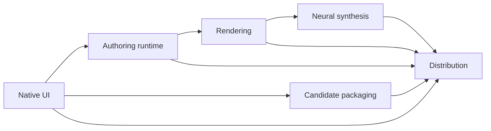

# Repository staleness and structural audit

Date: 2026-10-11, Asia/Seoul. Audited Git baseline: `dd20bf1690a23d1d04ecb0d8ce70c44086da3d07` (`master`).

Repository: `/Users/lhs/Downloads/project-seam-usable-alpha-u3-master`.

This is an English engineering audit of documentation, internal APIs, code lifecycle, and architecture. It records findings and a bounded repair sequence. It does not implement those repairs, change product acceptance, or resume development. The companion [evidence manifest](/Users/lhs/Downloads/project-seam-usable-alpha-u3-master/docs/reviews/REPOSITORY_STALENESS_AND_STRUCTURE_AUDIT_2026-10-11.evidence.json) records measurements, source hashes, fresh checks, and limitations.

## Judgment

**There is confirmed staleness, including an executable producer/consumer incompatibility. There are also structural maintenance risks, but the evidence does not justify a wholesale rewrite.**

The clearest defect is that current native project exports use schema 21 while the captured-teacher importer accepts only schemas 17–19. Its existing 12 tests pass, and a focused fixture probe confirms rejection of both 20 and 21. This is safe refusal, but it disconnects a current producer from a training-data consumer.

Documentation has a separate ownership problem. The root design document describes an editor that has been retired; README routes readers to older status documents and describes removed CI jobs; neural API guidance mixes transport, request, and launch versions. An evidence generator still emits `CI_CONFIGURED` even though the repository's own source checker correctly reports GitHub Actions as deferred.

The architecture is organized into libraries and the extracted library link graph is acyclic. However, broad dependencies, large UI/controller files, and a remaining classic-layout coordinate contract make changes harder to localize. The helper-process API also discards the details needed to distinguish an expected child refusal from an unexpected crash in some negative tests.

The recurring pattern is **incomplete migration closure**: a new implementation lands while older consumers, guidance, or test assumptions retain the previous contract. The audit demonstrates this mechanism; it does not measure what percentage of development time it has consumed.

## Scope, method, and confidence

`git fetch origin` and `git pull --ff-only --no-rebase` completed before the audit; pull reported “Already up to date.” The baseline contains 3,024 tracked paths and 500 Markdown files. These counts describe inventory, not 500 documents read line by line.

The audit combined repository-wide searches with direct inspection of the current export/import boundary, neural worker APIs, native editor entrypoints, helper supervision, release evidence producers, dependency declarations, and selected historical tools. Static scans covered local Markdown links, literal CMake library dependencies, cross-library includes, and large production C++ files. A cached compilation database was inspected separately and is explicitly not fresh build evidence.

Findings use three evidence levels:

| Level | Meaning | Examples |
|---|---|---|
| Executed | A focused check or probe ran during this audit | Source closure, Phase 13A contracts, importer tests and schema probe |
| Source-confirmed | Current code or documents directly establish the behavior | Retired CI claim, failure-detail loss, positional CLI parsing |
| Structural inference | Evidence establishes a maintenance risk, not a measured incident | Broad dependency fan-out, concentrated UI state, duplicated coordinate concepts |

Two implementation files were already modified: [candidate package commands](/Users/lhs/Downloads/project-seam-usable-alpha-u3-master/apps/seam-voicebank-cli/candidate_package_commands.cpp) and [sample-review CLI tests](/Users/lhs/Downloads/project-seam-usable-alpha-u3-master/tests/test_sample_review_cli.cpp). They were preserved. Findings about landed behavior in those files use their `HEAD` versions. Pending implementation is not credited as a completed repair.

This audit did not run a native build, full CTest, sanitizer suite, GUI interaction, audio/listening session, DAW, screen reader, signing, Windows acceptance, model training, or external reviewer acceptance. It did not compare third-party pins against current upstream releases or advisories. No dependency is labeled globally current, obsolete, or vulnerability-free on the strength of this report.

## Finding register

Priority describes repair order, not a security severity score. P1 interrupts a relevant current workflow; P2 affects engineering correctness or maintenance; P3 is bounded tooling or historical-evidence debt. No P0 defect was established.

| ID | Priority | Finding | Evidence | Consequence |
|---|---|---|---|---|
| F01 | P1 | Current project writer and captured-teacher importer disagree | Executed + source | Current schema-21 exports are refused |
| F02 | P2 | Evidence generation retains removed-CI claims | Source + passing checker | Operational state is inconsistent despite acceptance remaining blocked |
| F03 | P2 | Root design authority describes the retired editor | Source | Contributors can implement against the wrong design contract |
| F04 | P2 | README mixes current behavior and historical platform/status guidance | Source | Starting points and remaining work are harder to determine |
| F05 | P2 | Neural API guidance conflates independently versioned contracts | Source | Integrators can choose the wrong launch path or defaults |
| F06 | P2 | Helper-process API loses failed-child diagnostics | Source | Some negative tests cannot identify the intended refusal |
| F07 | P2 | Public legacy APIs lack a clear lifecycle index | Caller scan + source | Available symbols do not clearly identify the supported production path |
| F08 | P3 | Historical experiment scripts embed machine-specific inputs | Source | Reuse depends on undocumented local state |
| F09 | P3 | Singer-pilot CLI interprets `--help` as an output directory | Source | Normal discovery can start an output-producing operation |
| F10 | P3 | Historical reports link to missing transient outputs | Link scan | Some past evidence cannot be reopened from this checkout |

### F01 — The current native export cannot enter the captured-teacher importer

The [project codec](/Users/lhs/Downloads/project-seam-usable-alpha-u3-master/libs/seam-formats/include/seam/formats/project_json.hpp:24) sets `kSchemaVersion = 21`. The [export service](/Users/lhs/Downloads/project-seam-usable-alpha-u3-master/libs/seam-authoring-runtime/src/export_service.cpp:689) uses this codec, including encoding the packaged project at line 816. The [writer](/Users/lhs/Downloads/project-seam-usable-alpha-u3-master/libs/seam-formats/src/project_json.cpp:706) emits that version.

By contrast, [capture_inputs](/Users/lhs/Downloads/project-seam-usable-alpha-u3-master/tools/voice_model_training/prepare_captured_teacher.py:74) verifies the committed export receipt and file digests, then explicitly restricts the project to schemas 17–19 at lines 103–106. Every schema-21 project is rejected at that predicate, before its new semantics can be considered.

This consumer is still connected to an advertised workflow: the [training README](/Users/lhs/Downloads/project-seam-usable-alpha-u3-master/tools/voice_model_training/README.md:39) documents frozen evaluation capture through `seam_singer_pilot`, and [render_frozen_evaluation.py](/Users/lhs/Downloads/project-seam-usable-alpha-u3-master/tools/voice_model_training/render_frozen_evaluation.py:65) calls the pilot and then `capture_inputs` on its output. Consequently, the mismatch also affects that source-defined evaluation route when using a current pilot build. This audit did not execute the full route.

Fresh verification:

| Check | Result |
|---|---|
| Existing captured-teacher unittest module | 12 passed, zero skipped |
| Existing fixture rewritten as schema 19, with receipt digests recomputed | Accepted |
| Same fixture marked schema 20, with receipt digests recomputed | Refused |
| Same fixture marked schema 21, with receipt digests recomputed | Refused |

Both refusals report `Require captured project schema 17/18/19 and candidate metadata`. The [existing test](/Users/lhs/Downloads/project-seam-usable-alpha-u3-master/tools/voice_model_training/test_prepare_captured_teacher.py:109) even preserves schema-20 rejection. Passing this suite therefore does not establish compatibility with the current writer.

The probe changes the schema field in an existing fixture; it is not a complete native schema-21 export or training run. It isolates the version barrier. The source comparison establishes why genuine current exports encounter it.

**Repair direction:** decide and implement how capture handles schema-20 reading hints and schema-21 installation provenance. Add a current native-writer-to-consumer fixture or integration check. Preserve the receipt, path, identity, tamper, and unsupported-selection refusals. A blind upper-bound increase, silent version downgrade, or fabricated installation provenance would not be an adequate repair.

**Acceptance:** a supported project emitted by the current native writer is captured successfully with exact receipt bindings; incompatible selections remain explicitly refused; changing the writer schema forces the consumer compatibility check to be revisited. No new model training is required merely to establish this format boundary.

### F02 — Executable evidence generation still says CI is configured

The repository no longer tracks GitHub workflow files; the remaining tracked `.github` file is `requirements-ci.txt`. Workflow removal is recorded in commit `6632f584`.

Nevertheless, [generate_phase13a_evidence.py](/Users/lhs/Downloads/project-seam-usable-alpha-u3-master/scripts/generate_phase13a_evidence.py:80) unconditionally writes `implementationState: CI_CONFIGURED` at line 85 after its local work. The [mandatory validation matrix](/Users/lhs/Downloads/project-seam-usable-alpha-u3-master/docs/phase13a/mandatory-validation-matrix.json:22) contains 14 occurrences of `CI_CONFIGURED` across its records.

The [source contract checker](/Users/lhs/Downloads/project-seam-usable-alpha-u3-master/scripts/verify_phase13a_contracts.py:48) acknowledges deferred CI. It freshly passed and printed `githubActions=DEFERRED; pipelineExecution=NOT_CHECKED`. This is an inconsistency between two maintained machine-facing descriptions of repository state.

The generator still sets acceptance to `BLOCKED`, and external runtime evidence remains `NOT_RUN`; this finding does **not** establish a false release authorization. Nor was the generator executed during the audit: its main path builds and packages artifacts. The problematic assignment is directly visible in source.

**Repair direction:** make the evidence producer and matrix distinguish local implementation availability, configured automation, and executed external evidence. Preserve blocked acceptance and the decision to defer GitHub CI. Add a focused assertion against the intended state semantics; restoring CI is outside this repair.

**Acceptance:** the local checker, generated evidence, and current matrix agree about deferred automation without promoting any unexecuted platform result.

### F03 — DESIGN.md is an outdated authority for the main editor

[DESIGN.md](/Users/lhs/Downloads/project-seam-usable-alpha-u3-master/DESIGN.md:5) identifies plum/teal as the signature system and says the current design is extracted from `EditorSceneTheme`, `EditorSceneLayout`, and `RasterCanvas`. Its rules direct contributors to extend those themes.

The [current README](/Users/lhs/Downloads/project-seam-usable-alpha-u3-master/README.md:76) instead describes the SING shell, EMO/SCENE looks, and CoreGraphics/CoreText implementation. The [standalone paint path](/Users/lhs/Downloads/project-seam-usable-alpha-u3-master/libs/seam-standalone/src/native_editor_app.cpp:2094) and [CLAP paint path](/Users/lhs/Downloads/project-seam-usable-alpha-u3-master/libs/seam-clap-editor/src/editor_runtime_paint.cpp:116) use the shell or an unavailable-editor notice. The [fallback](/Users/lhs/Downloads/project-seam-usable-alpha-u3-master/libs/seam-native-ui/src/editor_scene.cpp:191) is not a second functional classic editor.

This is more than an old dated report: a root document presents itself as the current design system. A contributor following it can select the wrong color, layout, or renderer conventions.

**Repair direction:** make the root document a current design entrypoint and explicitly identify superseded editor guidance. Preserve still-applicable Voicebank Studio and raster utility material. The existence of an obsolete editor description is not evidence that every `RasterCanvas` or old theme use should be removed.

**Acceptance:** the root design guidance points to the active shell contract, identifies which surfaces still use other rendering infrastructure, and contains no instruction to implement a retired main-editor surface.

### F04 — README's current-state routing is internally inconsistent

[README lines 51–67](/Users/lhs/Downloads/project-seam-usable-alpha-u3-master/README.md:51) discuss Windows CI jobs and their repair state in the present tense, although those workflows have been removed. These may be valid historical observations; their current placement does not distinguish past execution from available automation.

[README line 74](/Users/lhs/Downloads/project-seam-usable-alpha-u3-master/README.md:74) routes “current maturity” readers to older Korean status documents. [STATUS_KO.md](/Users/lhs/Downloads/project-seam-usable-alpha-u3-master/docs/STATUS_KO.md:3) is dated August 25 and includes earlier CI/platform states. [REMAINING_TASKS_KO.md](/Users/lhs/Downloads/project-seam-usable-alpha-u3-master/docs/REMAINING_TASKS_KO.md:30) also retains `CI_CONFIGURED` descriptions. Their date or historical usefulness does not make them sufficient current entrypoints.

The [build section](/Users/lhs/Downloads/project-seam-usable-alpha-u3-master/README.md:514) includes usable presets, but the visible [native run guide](/Users/lhs/Downloads/project-seam-usable-alpha-u3-master/README.md:601) is a Phase 5 X11 workflow. Its X11 commands are not inherently wrong for that platform. The missing editorial step is a clear recommended macOS route to the current app bundle, whose target is defined in [CMake](/Users/lhs/Downloads/project-seam-usable-alpha-u3-master/CMakeLists.txt:998).

**Repair direction:** add one current build/run/status route; move historical CI observations under dated context; distinguish implementation, local execution, and product acceptance. Retain the Windows TODO and the explicit missing Windows/Linux vector-editor backend.

**Acceptance:** a reader can identify the supported development platform, current editor, correct build/run entrypoint, and canonical remaining-work source without reconciling phase-era status paragraphs. Earlier evidence stays available as history.

### F05 — Neural protocol documentation mixes different version dimensions

[NEURAL_PHONETIC_CONDITIONING.md](/Users/lhs/Downloads/project-seam-usable-alpha-u3-master/docs/formats/NEURAL_PHONETIC_CONDITIONING.md:3) begins with an older “current” request description, contains a local/uncommitted-work statement, and later says the package resolver requires protocol 1, identifying it with SNW1 transport at [line 198](/Users/lhs/Downloads/project-seam-usable-alpha-u3-master/docs/formats/NEURAL_PHONETIC_CONDITIONING.md:194).

Current source separates these concepts:

| Contract | Current behavior found | Source |
|---|---|---|
| Binary frame | SNW1 frame version 1 | [worker_protocol.cpp](/Users/lhs/Downloads/project-seam-usable-alpha-u3-master/libs/seam-neural-synthesis/src/worker_protocol.cpp:24) |
| Score request metadata | Current revision 3; decoding preserves older revisions | [header](/Users/lhs/Downloads/project-seam-usable-alpha-u3-master/libs/seam-neural-synthesis/include/seam/neural_synthesis/neural_phrase_backend.hpp:14), [decoder](/Users/lhs/Downloads/project-seam-usable-alpha-u3-master/libs/seam-neural-synthesis/src/worker_protocol.cpp:315) |
| Package resolution | Recognizes protocol values 1, 2, and 3 | [resolver](/Users/lhs/Downloads/project-seam-usable-alpha-u3-master/libs/seam-neural-synthesis/src/neural_phrase_backend.cpp:125) |
| Legacy worker launch | Protocol 1, without the production bundle contract | [legacy launcher](/Users/lhs/Downloads/project-seam-usable-alpha-u3-master/libs/seam-neural-synthesis/src/neural_phrase_backend.cpp:348) |
| Production bundle launch | Protocol 3, metadata 3, explicit inference steps and resource budgets | [bundle launcher](/Users/lhs/Downloads/project-seam-usable-alpha-u3-master/libs/seam-neural-synthesis/src/neural_phrase_backend.cpp:356) |

The runtime README accurately documents v3 at [lines 254–263](/Users/lhs/Downloads/project-seam-usable-alpha-u3-master/tools/neural_runtime/README.md:254), but [lines 327–331](/Users/lhs/Downloads/project-seam-usable-alpha-u3-master/tools/neural_runtime/README.md:327) still describe a distinct production v2 launch contract as future work. The legacy launcher's refusal can remain intentional; the explanation of what is still unimplemented is stale.

`NeuralWorkerRunOptions` also defaults to protocol 1 and zero budgets, while its [inference-step comment](/Users/lhs/Downloads/project-seam-usable-alpha-u3-master/libs/seam-neural-synthesis/include/seam/neural_synthesis/neural_phrase_backend.hpp:43) names protocol 2. Production checks fail closed; this is an integration footgun, not evidence of silent unbounded production execution.

**Repair direction:** publish one compact version matrix separating frame, request metadata, launch contract, and package schema. Label legacy APIs and make production construction explicit. Do not increment SNW1 framing solely to make the numbers match.

**Acceptance:** documented examples select the current bundle path; older decoders and probes retain their stated compatibility; unsupported launch combinations have clear tests and errors.

### F06 — Failed child processes lose the evidence needed by callers

The [helper API](/Users/lhs/Downloads/project-seam-usable-alpha-u3-master/libs/seam-platform/include/seam/platform/helper_process.hpp:29) returns stdout/stderr only for successful completion. Its POSIX implementation [captures bounded streams](/Users/lhs/Downloads/project-seam-usable-alpha-u3-master/libs/seam-platform/src/helper_process.cpp:424), then [returns a generic failure](/Users/lhs/Downloads/project-seam-usable-alpha-u3-master/libs/seam-platform/src/helper_process.cpp:460) for nonzero exit or signal termination. The result does not preserve an exit code, signal, or those captured streams for the caller.

Several landed cases in [test_sample_review_cli.cpp](/Users/lhs/Downloads/project-seam-usable-alpha-u3-master/tests/test_sample_review_cli.cpp:47) assert only that `runBoundedHelperProcess` failed. A crash or sanitizer abort can satisfy that particular assertion, just as the intended command refusal can. Some cases also assert filesystem state, so this is not a claim that every such test is vacuous. No hidden crash was demonstrated during this audit.

The authoring helper header is a [compatibility alias](/Users/lhs/Downloads/project-seam-usable-alpha-u3-master/libs/seam-authoring-runtime/include/seam/authoring/helper_process.hpp:4), not a second independent process supervisor. Consolidation already exists; the missing information is in the shared result contract.

**Repair direction:** represent completed child outcomes with bounded output and termination details, while separating launch/timeout/cancellation/resource-limit failures. Preserve a success-only wrapper where existing consumers need that abstraction. Strengthen selected refusal tests to check their intended reason and reject unexpected crashes or sanitizer diagnostics.

**Acceptance:** an expected CLI refusal and a deliberately crashing child produce distinguishable results; existing process limits and cancellation behavior remain intact. Validate the affected targets after a complete dependent rebuild, as required by this repository's verification rules.

### F07 — Legacy public symbols are not the same as dead code

The public [advanceGenerationCampaign API](/Users/lhs/Downloads/project-seam-usable-alpha-u3-master/libs/seam-authoring-runtime/include/seam/authoring/generation_campaign.hpp:81) is explicitly legacy and omits durable request registration and terminal records. The [advanceGenerationRequest API](/Users/lhs/Downloads/project-seam-usable-alpha-u3-master/libs/seam-authoring-runtime/include/seam/authoring/generation_campaign.hpp:116) provides that newer lifecycle. The [legacy implementation](/Users/lhs/Downloads/project-seam-usable-alpha-u3-master/libs/seam-authoring-runtime/src/generation_campaign_advance.cpp:331) delegates to a shared implementation; it is not an entirely duplicated engine.

Textual caller searches found the legacy entrypoint in tests and a test helper, with no production app caller identified. Likewise, the production [neural phrase runner](/Users/lhs/Downloads/project-seam-usable-alpha-u3-master/libs/seam-authoring-runtime/src/neural_phrase_runner.cpp:99) uses the bundle path, while the legacy worker API remains useful for older probes. This is a source search, not proof that no external caller exists.

The issue is discoverability and lifecycle ownership. A public header offers choices whose guarantees differ materially, while documentation does not provide one maintained production-versus-compatibility index.

**Repair direction:** identify production, compatibility, fixture-only, experimental, and admission-blocked surfaces. Move a symbol to test/internal scope only after checking all supported consumers. Prefer an explicit legacy name or documentation to speculative deletion.

**Acceptance:** a new caller can select the durable production path from the API documentation, and retained legacy tests state what historical contract they protect.

### F08 — Some historical tooling is tied to one workstation

[build_listener_packet_002.py](/Users/lhs/Downloads/project-seam-usable-alpha-u3-master/tools/singing_quality/build_listener_packet_002.py:25) contains a fixed repository path, `/tmp` inputs, and a dated corpus location under `/Users/lhs`; it also creates its output directory at module import. A [historical guide](/Users/lhs/Downloads/project-seam-usable-alpha-u3-master/docs/implementation/LISTENING_PACKET_002_GUIDE_2026-10-04.md:32) still shows it as a direct command.

Selected acoustic experiments also embed checkpoint paths: [encoder/denoiser crossover](/Users/lhs/Downloads/project-seam-usable-alpha-u3-master/tools/voice_model_training/acoustic_encoder_denoiser_crossover.py:170), [sampler trace](/Users/lhs/Downloads/project-seam-usable-alpha-u3-master/tools/voice_model_training/acoustic_sampler_trace.py:243), and [gradient probe](/Users/lhs/Downloads/project-seam-usable-alpha-u3-master/tools/voice_model_training/acoustic_gradient_probe.py:201). These may be intentional historical experiments, including exact artifact bindings. Their existence is not itself a production defect.

The [current singing-quality README](/Users/lhs/Downloads/project-seam-usable-alpha-u3-master/tools/singing_quality/README.md:149) points to the newer explicit-input listener-packet flow. That is evidence of a migration, not proof that its listening or quality acceptance is complete.

**Repair direction:** label historical scripts and identify their required artifact snapshots. Parameterize paths and remove import-time output creation only if the script remains a supported workflow. Preserve exact identities where they matter; never silently substitute a newer model for a missing historical checkpoint.

**Acceptance:** the supported command accepts explicit inputs and a new output directory; archival commands clearly state their fixed snapshot requirements. Importing a supported module does not create a packet.

### F09 — CLI help discovery can initiate singer-pilot output

[seam_singer_pilot main](/Users/lhs/Downloads/project-seam-usable-alpha-u3-master/apps/seam-singer-pilot/main.cpp:28) validates positional arguments and treats `argv[1]` as an output directory at line 41. With `argc == 2`, `--help` satisfies that positional shape and enters packet-generation behavior rather than displaying help. It was not executed with `--help` during this audit.

The tool has substantial [mode and determinism tests](/Users/lhs/Downloads/project-seam-usable-alpha-u3-master/tests/test_singer_pilot_cli.py); it must not be described as generally untested. The gap is the discovery contract.

**Repair direction:** recognize help before any filesystem or rendering operation and reject unknown options explicitly, while preserving supported positional modes.

**Acceptance:** `--help` prints usage successfully and creates no output, including no directory named `--help`. Existing modes and determinism checks remain valid.

### F10 — Missing links concern historical outputs, not demonstrated source loss

The heuristic scan examined 611 local inline Markdown file links and found six unresolved occurrences across three reports, referring to five unique target files:

| Historical report | Missing target category | Occurrences |
|---|---|---:|
| [September 22 finishing plan](/Users/lhs/Downloads/project-seam-usable-alpha-u3-master/SEAM_PROGRESS_AND_FINISHING_PLAN_2026-09-22_KO.md:52) | Two temporary `/tmp` logs | 2 |
| [September 12 roadmap](/Users/lhs/Downloads/project-seam-usable-alpha-u3-master/SEAM_PROGRESS_AND_REVISED_ROADMAP_2026-09-12.md:50) | Build-directory audit snapshot and CTest output; snapshot linked twice | 3 |
| [September 5 virtual-singer roadmap](/Users/lhs/Downloads/project-seam-usable-alpha-u3-master/VIRTUAL_SINGER_FEASIBILITY_AND_CODE_ROADMAP_2026-09-05.md:289) | Generated production-brief JSON | 1 |

The fresh tracked-source closure check passed. These observations do not establish a missing tracked source file or an unbuildable checkout. They establish that certain historical claims cannot be inspected through their original local links now.

**Repair direction:** mark unavailable historical attachments honestly and use durable artifact locations plus hashes for evidence that must remain reviewable. Do not reconstruct a historical PASS using newly generated files.

**Acceptance:** current status claims point to available evidence; unavailable historical receipts are labeled as such. The scan ignores remote URLs and fragments and does not enumerate reference-style links or every code-span path, so “all repository links are valid” would remain an unsupported claim.

## Structural assessment

### S01 — The library graph is acyclic, but several boundaries are broad

The static CMake extraction found 30 literal `add_library` targets and no nontrivial strongly connected components. It combines conditional branches; it is not the resolved dependency graph of a newly configured platform build. The include scan separately identified 143 distinct cross-library include edges. Directory-level includes and CMake targets are different views and must not be treated as interchangeable cycle results.

| Target | Direct first-party library dependencies |
|---|---:|
| `seam_clap_editor` | 15 |
| `seam_native_ui` | 14 |
| `seam_authoring_runtime` | 10 |
| `seam_rendering` | 9 |
| `seam_standalone_authoring` | 8 |
| `seam_voicebank_studio_app` | 7 |

The following is a selected subset of actual link edges, omitting common core/domain/format dependencies:

Relevant declarations are in [authoring links](/Users/lhs/Downloads/project-seam-usable-alpha-u3-master/CMakeLists.txt:460), [candidate packaging](/Users/lhs/Downloads/project-seam-usable-alpha-u3-master/CMakeLists.txt:602), [rendering](/Users/lhs/Downloads/project-seam-usable-alpha-u3-master/CMakeLists.txt:658), and [native UI](/Users/lhs/Downloads/project-seam-usable-alpha-u3-master/CMakeLists.txt:821).

This coupling may be justified by the product: rendering needs trustworthy installed resources, and UI must express admission failures. The maintenance concern is that resource installation, trust decisions, rendering, and presentation are reachable through broad library interfaces. A change in one concept can require understanding several domains even without a cycle.

**Recommendation:** during a concrete workflow repair, inspect whether downstream code can consume an already-verified resource description instead of reaching further into installation policy. Do not add a new framework or split libraries solely to reduce a graph number. A useful boundary change should reduce the files or concepts touched by a real recurring change while preserving identity and admission checks.

### S02 — UI concentration and legacy geometry increase migration cost

The largest production C++ files in the inventory include:

| File | Lines |
|---|---:|
| [sing_shell.cpp](/Users/lhs/Downloads/project-seam-usable-alpha-u3-master/libs/seam-native-ui/src/design/sing_shell.cpp) | 5,842 |
| [editor_controller.cpp](/Users/lhs/Downloads/project-seam-usable-alpha-u3-master/libs/seam-native-ui/src/editor_controller.cpp) | 4,117 |
| [studio_app.cpp](/Users/lhs/Downloads/project-seam-usable-alpha-u3-master/apps/seam-voicebank-studio-native/studio_app.cpp) | 3,549 |
| [shell_overlays.cpp](/Users/lhs/Downloads/project-seam-usable-alpha-u3-master/libs/seam-native-ui/src/design/shell_overlays.cpp) | 3,213 |
| [application_controller.cpp](/Users/lhs/Downloads/project-seam-usable-alpha-u3-master/libs/seam-standalone/src/application_controller.cpp) | 3,028 |

Line count alone does not demonstrate poor code or a need to split a file. The stronger signal is semantic: [TextInputRequest](/Users/lhs/Downloads/project-seam-usable-alpha-u3-master/libs/seam-native-ui/include/seam/native_ui/editor_controller.hpp:104) still describes bounds in classic-painter coordinates and defaults to `ClassicSurface`, although the classic editor is gone. The [SING shell](/Users/lhs/Downloads/project-seam-usable-alpha-u3-master/libs/seam-native-ui/src/design/sing_shell.cpp:872) retains explicit legacy coordinate conversion and text-input translation.

This is a functioning migration adapter, not proof of a visible bug. It does mean pointer handling, native text input, accessibility geometry, resizing, and painting can depend on agreement between two layout concepts. That is a plausible source of repeated interaction repairs and review complexity; this audit did not measure its incident frequency.

**Recommendation:** choose a single owner for presented geometry, with typed anchors or one immutable frame geometry object consumed by paint/input/accessibility. Extract one coherent interaction boundary when working on it. Preserve gesture cancellation, frame preparation ordering, resize behavior, and the existing shared commands. A cosmetic file split that leaves two coordinate authorities would not resolve the problem.

### S03 — Verification has blind spots and potential fixed costs

F01 and F06 demonstrate two different test-quality issues: version-specific tests can preserve an obsolete boundary, and generic failure assertions can accept the wrong failure. More test volume alone does not address either issue. A current producer-to-consumer check and reason-specific negative assertions target the actual gaps.

The existing local `build/release/compile_commands.json` contains 882 entries for 678 unique translation-unit paths; 71 test files appear in multiple entries. `test_main.cpp` appears 124 times. These are cached build-configuration observations, not fresh build timings. Repeated compilation can be deliberate isolation, and the tiny shared test harness may have negligible cost. There is no measured basis here for deleting test targets or asserting a particular wasted-time percentage.

The [CMake source-identity logic](/Users/lhs/Downloads/project-seam-usable-alpha-u3-master/CMakeLists.txt:15) follows Git HEAD and configures a generated version header at [line 218](/Users/lhs/Downloads/project-seam-usable-alpha-u3-master/CMakeLists.txt:218). Ten production source files directly include that generated header in the textual scan. Even a documentation commit can therefore cause reconfiguration/restamping and downstream compilation or linking. Accurate artifact identity is intentional; removing this behavior casually would trade away an important invariant.

**Recommendation:** measure representative incremental and full rebuilds before optimizing. Separate focused implementation feedback from final candidate validation while keeping the full dependent-rebuild rule whenever shared library code changes. If identity stamping becomes material, design a development-versus-release strategy with explicit freshness guarantees and tests. Do not reduce correctness checks merely because the build graph looks large.

## What should remain, and what must not be called stale

### The U45 admission hold is intentional

The canonical [full-product contract](/Users/lhs/Downloads/project-seam-usable-alpha-u3-master/docs/product/full-product-beta-contract.json:7303) still records semantic validation as unavailable. A superficial comparison with the implemented typed adapter could suggest a stale status field. The [adapter's opening contract](/Users/lhs/Downloads/project-seam-usable-alpha-u3-master/tools/external_beta/full_product_gate.py:1) explicitly explains the hold: it checks declarations and bindings but does not yet establish all native replay, installation, measurement, or human semantics required for admission.

[Lines 65–77](/Users/lhs/Downloads/project-seam-usable-alpha-u3-master/tools/external_beta/full_product_gate.py:65) require a deliberate accepted contract revision and retain `U45_RECONCILIATION_HOLD`. The [reconciliation document](/Users/lhs/Downloads/project-seam-usable-alpha-u3-master/docs/implementation/U45_TYPED_AUDIT_RECONCILIATION.md:28) explicitly prohibits replacing the reader or removing that hold as incidental cleanup.

**Correction to the earlier development-economics diagnosis:** its shorthand treatment of this mismatch as stale metadata was incomplete. An implemented engineering adapter and unavailable canonical admission can coexist intentionally. Updating `UNAVAILABLE` to `IMPLEMENTED` is not a documentation-only fix and must not be included in a staleness cleanup.

### Compatibility readers are assets when their scope is explicit

The [project decoder](/Users/lhs/Downloads/project-seam-usable-alpha-u3-master/libs/seam-formats/src/project_json.cpp:779) accepts schemas 1–21. That preserves user data and is not obsolete merely because the writer emits 21. Likewise, [candidate resource decoding](/Users/lhs/Downloads/project-seam-usable-alpha-u3-master/libs/seam-voicebank-production/src/resource_candidate.cpp:674) retains older schemas while the writer emits schema 3 and [typed packaging](/Users/lhs/Downloads/project-seam-usable-alpha-u3-master/libs/seam-candidate-packaging/src/candidate_package.cpp:239) explicitly restricts what can be packaged. Decode compatibility and production admission are different contracts.

### Dependency metadata is internally aligned in the inspected scope

The [dependency lock](/Users/lhs/Downloads/project-seam-usable-alpha-u3-master/phase13a/dependency-lock.json) and [SBOM](/Users/lhs/Downloads/project-seam-usable-alpha-u3-master/SBOM.spdx.json) agree on the inspected CLAP, clap-wrapper, VST3 SDK, AudioUnitSDK, and OpenSSL pins. The fresh contract checker passed its dependency-pin checks. These observations do not establish upstream freshness, complete transitive dependency coverage, vulnerability status, or legal acceptance.

### Historical evidence and incomplete features need different labels

A dated experiment is not automatically a supported tool; a blocked release gate is not automatically a defect; a missing generated artifact is not automatically missing source; a passing unit suite is not musical acceptance. Current documentation should make those categories visible rather than forcing readers to infer them from filenames or phase numbers.

## Bounded remediation sequence

These are proposed engineering units for a later authorized implementation turn. This audit does not start them or declare a new development goal.

| Order | Unit and suggested owner | Concrete completion condition | Verification scope |
|---|---|---|---|
| 1 | Export/capture compatibility — formats + training-data owner | Supported current native export is consumed with schema-20/21 semantics explicitly handled | Current-writer boundary fixture, importer suite, retained tamper/refusal cases |
| 2 | Process outcome observability — platform + CLI-test owner | Intended refusal and unexpected crash are distinguishable | Supervisor outcome tests and selected CLI negatives; rebuilt dependents |
| 3 | Current documentation and API entrypoints — integrating owner | README, DESIGN, and neural version guidance agree with active source; historical material is labeled | Source-to-doc review and link checks; no product acceptance promotion |
| 4 | Evidence-state reconciliation — release tooling owner | Deferred CI is represented consistently in generator and matrix | Focused generator/schema checks plus Phase 13A source contracts |
| 5 | Tool lifecycle cleanup — tool owners | Supported, experimental, and archived scripts are distinguishable; pilot help has no side effects | Help/no-output check; explicit-input fixture for any retained supported script |
| 6 | One measured structural improvement — UI/runtime owner | A real change crosses fewer concepts without weakening geometry or admission guarantees | Relevant interaction or runtime boundary tests plus measured change/build comparison |

Units 1–4 address concrete mismatches before broad refactoring. Unit 6 should be selected from an observed change or defect, not used as permission to redesign all layers. Preserve Windows TODO, deferred GitHub CI, backward project readability, bounded process supervision, and canonical admission holds throughout.

For each future API/schema change, migration closure should answer four short questions: who writes it, who reads or launches it, which current document names it, and which test crosses the boundary? That small discipline would have exposed F01 and F05 without requiring a new large governance system.

## Fresh verification receipt and limits

| Operation | Result and meaning |
|---|---|
| `git fetch origin` | Exit 0; remote refs refreshed |
| `git pull --ff-only --no-rebase` | Exit 0; already up to date |
| `python3 -B scripts/verify_tracked_source_closure.py --root .` | `SOURCE_CLOSURE=PASS`; checker-defined source closure only |
| `python3 -B scripts/verify_phase13a_contracts.py --root .` | Dependency pins, mandatory-validation documents, and packaging source checks passed; CI deferred; external runtime not run |
| `python3 -B -m unittest tools.voice_model_training.test_prepare_captured_teacher -v` | 12 tests passed, zero skipped, 0.143 seconds in the recorded run |
| Focused schema fixture probe | 19 accepted; 20 and 21 refused with the documented version error |
| Static dependency and link inventory | 30 literal library targets; no nontrivial library-link SCC; 611 local inline links examined; six unresolved historical occurrences |
| Existing compilation database | Inspected only; not regenerated or treated as current binary validation |

No overall completion percentage is inferred from these checks. They answer the present question about staleness and structure, and cannot substitute for user-visible workflow, sound quality, release, platform, or human acceptance evidence.

The finding list is evidence-backed but not exhaustive. Repository-wide scans identify candidates; targeted source reads establish the findings above. The highest-value next action is to close the demonstrated export/import boundary and clarify current contracts, then measure one structural improvement against a real workflow. This preserves the project's useful correctness infrastructure while addressing specific sources of avoidable rework.
